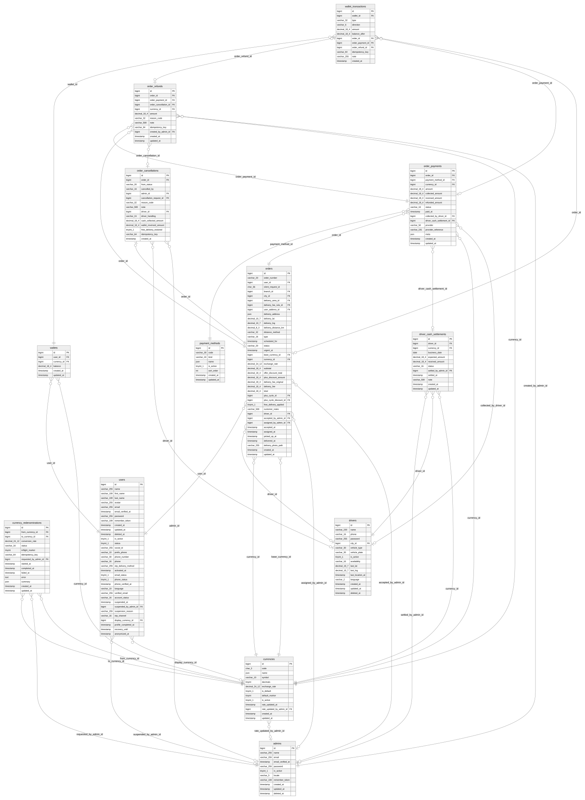
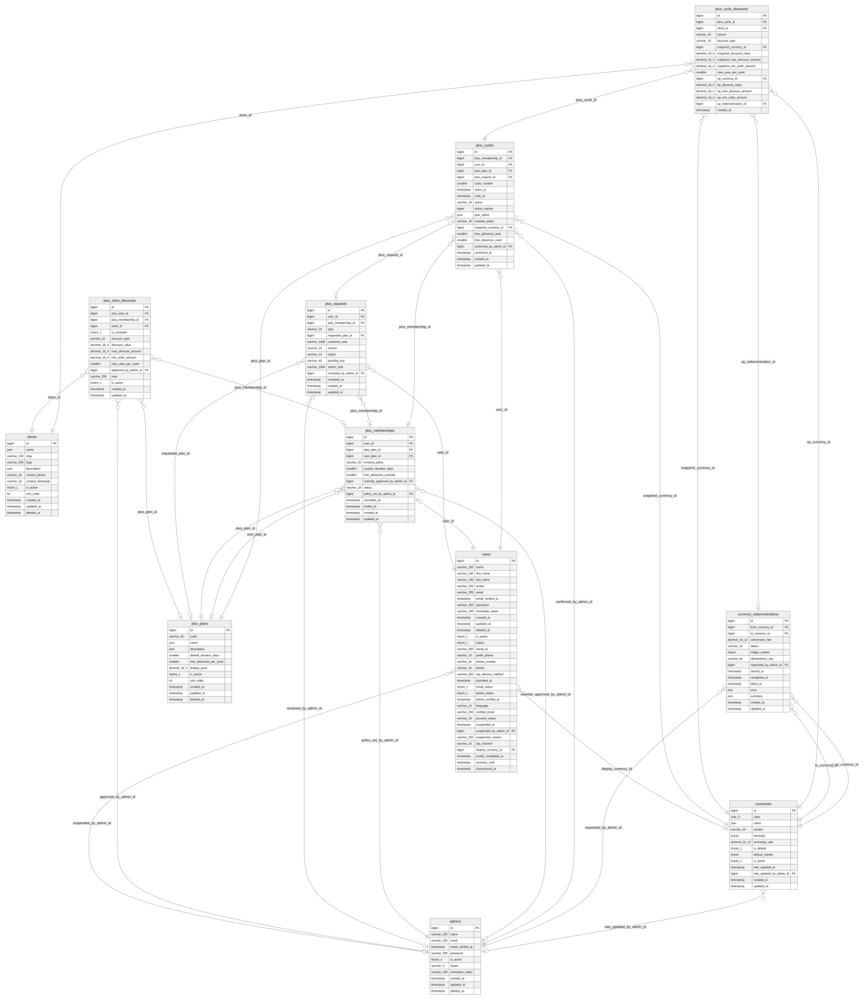
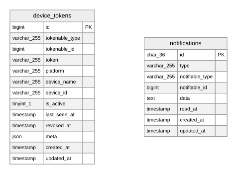
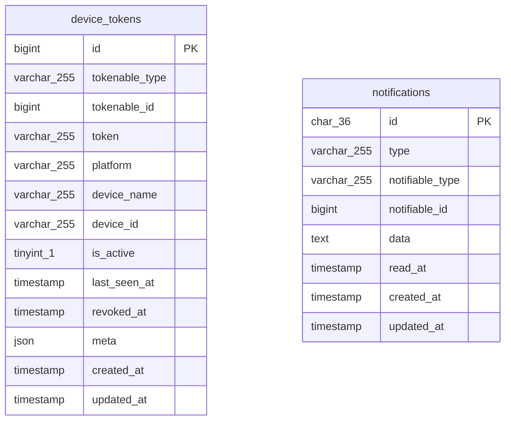
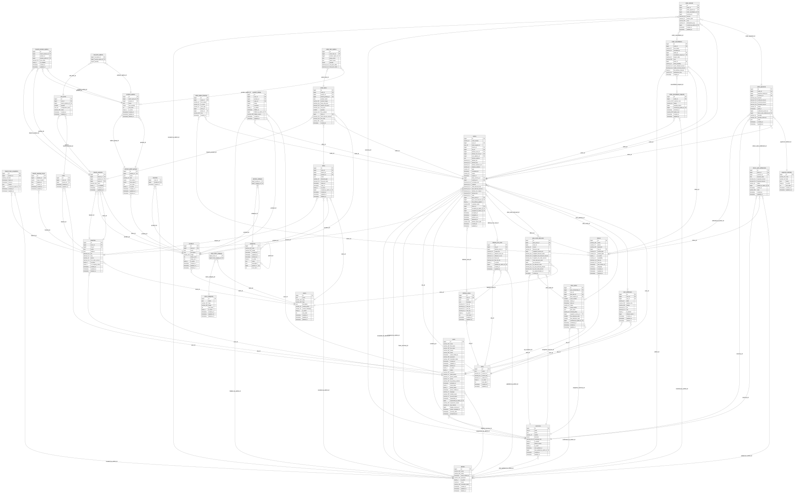

# WAFFRLI — ER diagrams (as built)

Generated by `php artisan waffrli:db-docs` from the live MySQL schema (`8.4.13`). Do not edit by hand.
Table details: [README.md](README.md). The approved design baseline is [`../erd.md`](../erd.md).

Cardinality: `}o--||` many-to-one (required FK), `}o--o|` many-to-one (nullable FK), `|o--||` one-to-one (unique FK).

## All tables

```mermaid
erDiagram
    admin_audit_logs }o--o| admins : "admin_id"
    branch_hour_exceptions }o--|| branches : "branch_id"
    branch_hour_exceptions }o--|| admins : "created_by_admin_id"
    branch_opening_hours }o--|| branches : "branch_id"
    branch_product_options }o--|| branch_products : "branch_product_id"
    branch_product_options }o--|| branch_products : "product_id"
    branch_product_options }o--|| product_options : "product_id"
    branch_product_options }o--|| product_options : "product_option_id"
    branch_products }o--|| branches : "branch_id"
    branch_products }o--|| products : "product_id"
    branch_products }o--|| branches : "store_id"
    branch_products }o--|| products : "store_id"
    branches }o--|| cities : "city_id"
    branches }o--|| stores : "store_id"
    cart_item_options }o--|| cart_items : "cart_item_id"
    cart_item_options }o--|| product_options : "product_option_id"
    cart_items }o--|| branch_products : "branch_product_id"
    cart_items }o--|| carts : "cart_id"
    carts }o--|| branches : "branch_id"
    carts }o--|| users : "user_id"
    categories }o--o| categories : "parent_id"
    currencies }o--o| admins : "rate_updated_by_admin_id"
    currency_redenominations }o--|| currencies : "from_currency_id"
    currency_redenominations }o--|| admins : "requested_by_admin_id"
    currency_redenominations }o--|| currencies : "to_currency_id"
    delivery_areas }o--|| cities : "city_id"
    delivery_fee_rules }o--o| cities : "city_id"
    delivery_fee_rules }o--o| delivery_areas : "delivery_area_id"
    delivery_fee_rules }o--o| admins : "updated_by_admin_id"
    driver_cash_settlements }o--|| currencies : "currency_id"
    driver_cash_settlements }o--|| drivers : "driver_id"
    driver_cash_settlements }o--o| admins : "settled_by_admin_id"
    drivers }o--|| cities : "city_id"
    favorites }o--|| products : "product_id"
    favorites }o--|| users : "user_id"
    marketing_broadcasts }o--|| admins : "admin_id"
    marketing_broadcasts }o--o| cities : "city_id"
    model_has_permissions }o--|| permissions : "permission_id"
    model_has_roles }o--|| roles : "role_id"
    offers }o--o| branches : "branch_id"
    offers }o--|| admins : "created_by_admin_id"
    offers }o--o| products : "product_id"
    offers }o--|| stores : "store_id"
    order_cancellation_requests }o--|| orders : "order_id"
    order_cancellation_requests }o--o| admins : "resolved_by_admin_id"
    order_cancellations }o--o| admins : "admin_id"
    order_cancellations }o--o| order_cancellation_requests : "cancellation_request_id"
    order_cancellations }o--o| drivers : "driver_id"
    order_cancellations |o--|| orders : "order_id"
    order_item_options }o--|| order_items : "order_item_id"
    order_item_options }o--o| product_options : "product_option_id"
    order_items }o--o| branch_products : "branch_product_id"
    order_items }o--o| offers : "offer_id"
    order_items }o--|| orders : "order_id"
    order_items }o--|| products : "product_id"
    order_payments }o--o| drivers : "collected_by_driver_id"
    order_payments }o--|| currencies : "currency_id"
    order_payments }o--o| driver_cash_settlements : "driver_cash_settlement_id"
    order_payments }o--|| orders : "order_id"
    order_payments }o--|| payment_methods : "payment_method_id"
    order_refunds }o--|| admins : "created_by_admin_id"
    order_refunds }o--|| currencies : "currency_id"
    order_refunds }o--o| order_cancellations : "order_cancellation_id"
    order_refunds }o--|| orders : "order_id"
    order_refunds }o--|| order_payments : "order_payment_id"
    order_status_histories }o--o| drivers : "driver_id"
    order_status_histories }o--|| orders : "order_id"
    orders }o--o| admins : "accepted_by_admin_id"
    orders }o--o| admins : "assigned_by_admin_id"
    orders }o--|| currencies : "base_currency_id"
    orders }o--|| branches : "branch_id"
    orders }o--|| cities : "city_id"
    orders }o--|| currencies : "currency_id"
    orders }o--o| delivery_areas : "delivery_area_id"
    orders }o--o| delivery_fee_rules : "delivery_fee_rule_id"
    orders }o--o| drivers : "driver_id"
    orders }o--o| plus_cycle_discounts : "plus_cycle_discount_id"
    orders }o--o| plus_cycles : "plus_cycle_id"
    orders }o--o| user_addresses : "user_address_id"
    orders }o--|| users : "user_id"
    plus_cycle_discounts }o--|| currencies : "op_currency_id"
    plus_cycle_discounts }o--o| currency_redenominations : "op_redenomination_id"
    plus_cycle_discounts }o--|| plus_cycles : "plus_cycle_id"
    plus_cycle_discounts }o--|| currencies : "snapshot_currency_id"
    plus_cycle_discounts }o--|| stores : "store_id"
    plus_cycles }o--|| admins : "confirmed_by_admin_id"
    plus_cycles }o--|| plus_memberships : "plus_membership_id"
    plus_cycles }o--|| plus_plans : "plus_plan_id"
    plus_cycles |o--o| plus_requests : "plus_request_id"
    plus_cycles }o--|| currencies : "snapshot_currency_id"
    plus_cycles }o--|| users : "user_id"
    plus_memberships }o--o| plus_plans : "next_plan_id"
    plus_memberships }o--o| admins : "override_approved_by_admin_id"
    plus_memberships }o--|| plus_plans : "plus_plan_id"
    plus_memberships }o--|| admins : "policy_set_by_admin_id"
    plus_memberships |o--|| users : "user_id"
    plus_requests }o--o| plus_memberships : "plus_membership_id"
    plus_requests }o--o| plus_plans : "requested_plan_id"
    plus_requests }o--o| admins : "reviewed_by_admin_id"
    plus_requests }o--|| users : "user_id"
    plus_store_discounts }o--o| admins : "approved_by_admin_id"
    plus_store_discounts }o--o| plus_memberships : "plus_membership_id"
    plus_store_discounts }o--o| plus_plans : "plus_plan_id"
    plus_store_discounts }o--|| stores : "store_id"
    product_category }o--|| categories : "category_id"
    product_category }o--|| products : "product_id"
    product_option_groups }o--|| products : "product_id"
    product_options }o--|| product_option_groups : "option_group_id"
    product_options }o--|| product_option_groups : "product_id"
    product_ratings }o--o| admins : "hidden_by_admin_id"
    product_ratings }o--|| orders : "order_id"
    product_ratings }o--|| products : "product_id"
    product_ratings }o--|| users : "user_id"
    products }o--|| stores : "store_id"
    role_has_permissions }o--|| permissions : "permission_id"
    role_has_permissions }o--|| roles : "role_id"
    settings }o--o| admins : "updated_by_admin_id"
    store_store_category }o--|| store_categories : "store_category_id"
    store_store_category }o--|| stores : "store_id"
    user_addresses }o--|| cities : "city_id"
    user_addresses }o--|| users : "user_id"
    users }o--o| currencies : "display_currency_id"
    users }o--o| admins : "suspended_by_admin_id"
    wallet_transactions }o--o| orders : "order_id"
    wallet_transactions }o--o| order_payments : "order_payment_id"
    wallet_transactions |o--o| order_refunds : "order_refund_id"
    wallet_transactions }o--|| wallets : "wallet_id"
    wallets }o--|| currencies : "currency_id"
    wallets }o--|| users : "user_id"
```





Polymorphic (no FK): `admin_audit_logs.auditable_type/_id`, `device_tokens.tokenable_type/_id`, `model_has_permissions.model_type/_id`, `model_has_roles.model_type/_id`, `notifications.notifiable_type/_id`, `order_status_histories.actor_type/_id`, `otps.verifiable_type/_id`, `password_reset_grants.verifiable_type/_id`, `personal_access_tokens.tokenable_type/_id`.

## Financial: wallets, payments, ledger, refunds, cash, settlements

```mermaid
erDiagram
    currencies }o--o| admins : "rate_updated_by_admin_id"
    currency_redenominations }o--|| currencies : "from_currency_id"
    currency_redenominations }o--|| admins : "requested_by_admin_id"
    currency_redenominations }o--|| currencies : "to_currency_id"
    driver_cash_settlements }o--|| currencies : "currency_id"
    driver_cash_settlements }o--|| drivers : "driver_id"
    driver_cash_settlements }o--o| admins : "settled_by_admin_id"
    order_cancellations }o--o| admins : "admin_id"
    order_cancellations }o--o| drivers : "driver_id"
    order_cancellations |o--|| orders : "order_id"
    order_payments }o--o| drivers : "collected_by_driver_id"
    order_payments }o--|| currencies : "currency_id"
    order_payments }o--o| driver_cash_settlements : "driver_cash_settlement_id"
    order_payments }o--|| orders : "order_id"
    order_payments }o--|| payment_methods : "payment_method_id"
    order_refunds }o--|| admins : "created_by_admin_id"
    order_refunds }o--|| currencies : "currency_id"
    order_refunds }o--o| order_cancellations : "order_cancellation_id"
    order_refunds }o--|| orders : "order_id"
    order_refunds }o--|| order_payments : "order_payment_id"
    orders }o--o| admins : "accepted_by_admin_id"
    orders }o--o| admins : "assigned_by_admin_id"
    orders }o--|| currencies : "base_currency_id"
    orders }o--|| currencies : "currency_id"
    orders }o--o| drivers : "driver_id"
    orders }o--|| users : "user_id"
    users }o--o| currencies : "display_currency_id"
    users }o--o| admins : "suspended_by_admin_id"
    wallet_transactions }o--o| orders : "order_id"
    wallet_transactions }o--o| order_payments : "order_payment_id"
    wallet_transactions |o--o| order_refunds : "order_refund_id"
    wallet_transactions }o--|| wallets : "wallet_id"
    wallets }o--|| currencies : "currency_id"
    wallets }o--|| users : "user_id"
    admins {
        bigint id PK
        varchar_255 name
        varchar_255 email
        timestamp email_verified_at
        varchar_255 password
        tinyint_1 is_active
        varchar_5 locale
        varchar_100 remember_token
        timestamp created_at
        timestamp updated_at
        timestamp deleted_at
    }
    currencies {
        bigint id PK
        char_3 code
        json name
        varchar_10 symbol
        tinyint decimals
        decimal_24_12 exchange_rate
        tinyint_1 is_default
        tinyint default_marker
        tinyint_1 is_active
        timestamp rate_updated_at
        bigint rate_updated_by_admin_id FK
        timestamp created_at
        timestamp updated_at
    }
    currency_redenominations {
        bigint id PK
        bigint from_currency_id FK
        bigint to_currency_id FK
        decimal_24_12 conversion_rate
        varchar_16 status
        tinyint inflight_marker
        varchar_64 idempotency_key
        bigint requested_by_admin_id FK
        timestamp started_at
        timestamp completed_at
        timestamp failed_at
        text error
        json summary
        timestamp created_at
        timestamp updated_at
    }
    driver_cash_settlements {
        bigint id PK
        bigint driver_id FK
        bigint currency_id FK
        date business_date
        decimal_18_4 expected_amount
        decimal_18_4 received_amount
        varchar_16 status
        bigint settled_by_admin_id FK
        timestamp settled_at
        varchar_500 note
        timestamp created_at
        timestamp updated_at
    }
    drivers {
        bigint id PK
        varchar_150 name
        varchar_16 phone
        varchar_255 password
        bigint city_id FK
        varchar_30 vehicle_type
        varchar_30 vehicle_plate
        tinyint_1 is_active
        varchar_16 availability
        decimal_10_7 last_lat
        decimal_10_7 last_lng
        timestamp last_location_at
        varchar_2 language
        timestamp created_at
        timestamp updated_at
        timestamp deleted_at
    }
    order_cancellations {
        bigint id PK
        bigint order_id FK
        varchar_20 from_status
        varchar_16 cancelled_by
        bigint admin_id FK
        bigint cancellation_request_id FK
        varchar_32 reason_code
        varchar_500 note
        bigint driver_id FK
        varchar_24 driver_handling
        decimal_18_4 cash_collected_amount
        decimal_18_4 wallet_reversed_amount
        tinyint_1 free_delivery_restored
        varchar_64 idempotency_key
        timestamp created_at
    }
    order_payments {
        bigint id PK
        bigint order_id FK
        bigint payment_method_id FK
        bigint currency_id FK
        decimal_18_4 amount
        decimal_18_4 collected_amount
        decimal_18_4 reversed_amount
        decimal_18_4 refunded_amount
        varchar_16 status
        timestamp paid_at
        bigint collected_by_driver_id FK
        bigint driver_cash_settlement_id FK
        varchar_50 provider
        varchar_191 provider_reference
        json meta
        timestamp created_at
        timestamp updated_at
    }
    order_refunds {
        bigint id PK
        bigint order_id FK
        bigint order_payment_id FK
        bigint order_cancellation_id FK
        bigint currency_id FK
        decimal_18_4 amount
        varchar_32 reason_code
        varchar_500 note
        varchar_64 idempotency_key
        bigint created_by_admin_id FK
        timestamp created_at
        timestamp updated_at
    }
    orders {
        bigint id PK
        varchar_20 order_number
        bigint user_id FK
        char_36 client_request_id
        bigint branch_id FK
        bigint city_id FK
        bigint delivery_area_id FK
        bigint delivery_fee_rule_id FK
        bigint user_address_id FK
        json delivery_address
        decimal_10_7 delivery_lat
        decimal_10_7 delivery_lng
        decimal_8_3 delivery_distance_km
        varchar_32 distance_method
        varchar_16 type
        timestamp scheduled_for
        varchar_20 status
        timestamp urgent_at
        bigint base_currency_id FK
        bigint currency_id FK
        decimal_24_12 exchange_rate
        decimal_18_4 subtotal
        decimal_18_4 offer_discount_total
        decimal_18_4 plus_discount_amount
        decimal_18_4 delivery_fee_original
        decimal_18_4 delivery_fee
        decimal_18_4 total
        bigint plus_cycle_id FK
        bigint plus_cycle_discount_id FK
        tinyint_1 free_delivery_applied
        varchar_500 customer_notes
        bigint driver_id FK
        bigint accepted_by_admin_id FK
        bigint assigned_by_admin_id FK
        timestamp accepted_at
        timestamp assigned_at
        timestamp picked_up_at
        timestamp delivered_at
        varchar_255 delivery_photo_path
        timestamp created_at
        timestamp updated_at
    }
    payment_methods {
        bigint id PK
        varchar_30 code
        varchar_16 kind
        json name
        tinyint_1 is_active
        int sort_order
        timestamp created_at
        timestamp updated_at
    }
    users {
        bigint id PK
        varchar_255 name
        varchar_100 first_name
        varchar_100 last_name
        varchar_255 avatar
        varchar_255 email
        timestamp email_verified_at
        varchar_255 password
        varchar_100 remember_token
        timestamp created_at
        timestamp updated_at
        timestamp deleted_at
        tinyint_1 is_active
        tinyint_1 status
        varchar_255 social_id
        varchar_10 prefix_phone
        varchar_30 phone_number
        varchar_16 phone
        varchar_255 otp_delivery_method
        timestamp activated_at
        tinyint_1 email_status
        tinyint_1 phone_status
        timestamp phone_verified_at
        varchar_10 language
        varchar_255 verified_email
        varchar_16 account_status
        timestamp suspended_at
        bigint suspended_by_admin_id FK
        varchar_255 suspension_reason
        varchar_16 otp_channel
        bigint display_currency_id FK
        timestamp profile_completed_at
        timestamp recovery_until
        timestamp anonymized_at
    }
    wallet_transactions {
        bigint id PK
        bigint wallet_id FK
        varchar_32 type
        varchar_6 direction
        decimal_18_4 amount
        decimal_18_4 balance_after
        bigint order_id FK
        bigint order_payment_id FK
        bigint order_refund_id FK
        varchar_64 idempotency_key
        varchar_255 note
        timestamp created_at
    }
    wallets {
        bigint id PK
        bigint user_id FK
        bigint currency_id FK
        decimal_18_4 balance
        timestamp created_at
        timestamp updated_at
    }
```





## PLUS membership

```mermaid
erDiagram
    currencies }o--o| admins : "rate_updated_by_admin_id"
    currency_redenominations }o--|| currencies : "from_currency_id"
    currency_redenominations }o--|| admins : "requested_by_admin_id"
    currency_redenominations }o--|| currencies : "to_currency_id"
    plus_cycle_discounts }o--|| currencies : "op_currency_id"
    plus_cycle_discounts }o--o| currency_redenominations : "op_redenomination_id"
    plus_cycle_discounts }o--|| plus_cycles : "plus_cycle_id"
    plus_cycle_discounts }o--|| currencies : "snapshot_currency_id"
    plus_cycle_discounts }o--|| stores : "store_id"
    plus_cycles }o--|| admins : "confirmed_by_admin_id"
    plus_cycles }o--|| plus_memberships : "plus_membership_id"
    plus_cycles }o--|| plus_plans : "plus_plan_id"
    plus_cycles |o--o| plus_requests : "plus_request_id"
    plus_cycles }o--|| currencies : "snapshot_currency_id"
    plus_cycles }o--|| users : "user_id"
    plus_memberships }o--o| plus_plans : "next_plan_id"
    plus_memberships }o--o| admins : "override_approved_by_admin_id"
    plus_memberships }o--|| plus_plans : "plus_plan_id"
    plus_memberships }o--|| admins : "policy_set_by_admin_id"
    plus_memberships |o--|| users : "user_id"
    plus_requests }o--o| plus_memberships : "plus_membership_id"
    plus_requests }o--o| plus_plans : "requested_plan_id"
    plus_requests }o--o| admins : "reviewed_by_admin_id"
    plus_requests }o--|| users : "user_id"
    plus_store_discounts }o--o| admins : "approved_by_admin_id"
    plus_store_discounts }o--o| plus_memberships : "plus_membership_id"
    plus_store_discounts }o--o| plus_plans : "plus_plan_id"
    plus_store_discounts }o--|| stores : "store_id"
    users }o--o| currencies : "display_currency_id"
    users }o--o| admins : "suspended_by_admin_id"
    admins {
        bigint id PK
        varchar_255 name
        varchar_255 email
        timestamp email_verified_at
        varchar_255 password
        tinyint_1 is_active
        varchar_5 locale
        varchar_100 remember_token
        timestamp created_at
        timestamp updated_at
        timestamp deleted_at
    }
    currencies {
        bigint id PK
        char_3 code
        json name
        varchar_10 symbol
        tinyint decimals
        decimal_24_12 exchange_rate
        tinyint_1 is_default
        tinyint default_marker
        tinyint_1 is_active
        timestamp rate_updated_at
        bigint rate_updated_by_admin_id FK
        timestamp created_at
        timestamp updated_at
    }
    currency_redenominations {
        bigint id PK
        bigint from_currency_id FK
        bigint to_currency_id FK
        decimal_24_12 conversion_rate
        varchar_16 status
        tinyint inflight_marker
        varchar_64 idempotency_key
        bigint requested_by_admin_id FK
        timestamp started_at
        timestamp completed_at
        timestamp failed_at
        text error
        json summary
        timestamp created_at
        timestamp updated_at
    }
    plus_cycle_discounts {
        bigint id PK
        bigint plus_cycle_id FK
        bigint store_id FK
        varchar_16 source
        varchar_10 discount_type
        bigint snapshot_currency_id FK
        decimal_18_4 snapshot_discount_value
        decimal_18_4 snapshot_max_discount_amount
        decimal_18_4 snapshot_min_order_amount
        smallint max_uses_per_cycle
        bigint op_currency_id FK
        decimal_18_4 op_discount_value
        decimal_18_4 op_max_discount_amount
        decimal_18_4 op_min_order_amount
        bigint op_redenomination_id FK
        timestamp created_at
    }
    plus_cycles {
        bigint id PK
        bigint plus_membership_id FK
        bigint user_id FK
        bigint plus_plan_id FK
        bigint plus_request_id FK
        smallint cycle_number
        timestamp starts_at
        timestamp ends_at
        varchar_16 status
        bigint active_marker
        json plan_name
        varchar_16 renewal_policy
        bigint snapshot_currency_id FK
        smallint free_deliveries_total
        smallint free_deliveries_used
        bigint confirmed_by_admin_id FK
        timestamp confirmed_at
        timestamp created_at
        timestamp updated_at
    }
    plus_memberships {
        bigint id PK
        bigint user_id FK
        bigint plus_plan_id FK
        bigint next_plan_id FK
        varchar_16 renewal_policy
        smallint custom_duration_days
        smallint free_deliveries_override
        bigint override_approved_by_admin_id FK
        varchar_16 status
        bigint policy_set_by_admin_id FK
        timestamp cancelled_at
        timestamp ended_at
        timestamp created_at
        timestamp updated_at
    }
    plus_plans {
        bigint id PK
        varchar_50 code
        json name
        json description
        smallint default_duration_days
        smallint free_deliveries_per_cycle
        decimal_18_4 display_price
        tinyint_1 is_active
        int sort_order
        timestamp created_at
        timestamp updated_at
        timestamp deleted_at
    }
    plus_requests {
        bigint id PK
        bigint user_id FK
        bigint plus_membership_id FK
        varchar_16 type
        bigint requested_plan_id FK
        varchar_1000 customer_note
        varchar_16 source
        varchar_16 status
        varchar_40 pending_key
        varchar_1000 admin_note
        bigint reviewed_by_admin_id FK
        timestamp reviewed_at
        timestamp created_at
        timestamp updated_at
    }
    plus_store_discounts {
        bigint id PK
        bigint plus_plan_id FK
        bigint plus_membership_id FK
        bigint store_id FK
        tinyint_1 is_excluded
        varchar_10 discount_type
        decimal_18_4 discount_value
        decimal_18_4 max_discount_amount
        decimal_18_4 min_order_amount
        smallint max_uses_per_cycle
        bigint approved_by_admin_id FK
        varchar_255 note
        tinyint_1 is_active
        timestamp created_at
        timestamp updated_at
    }
    stores {
        bigint id PK
        json name
        varchar_120 slug
        varchar_255 logo
        json description
        varchar_16 contact_phone
        varchar_16 contact_whatsapp
        tinyint_1 is_active
        int sort_order
        timestamp created_at
        timestamp updated_at
        timestamp deleted_at
    }
    users {
        bigint id PK
        varchar_255 name
        varchar_100 first_name
        varchar_100 last_name
        varchar_255 avatar
        varchar_255 email
        timestamp email_verified_at
        varchar_255 password
        varchar_100 remember_token
        timestamp created_at
        timestamp updated_at
        timestamp deleted_at
        tinyint_1 is_active
        tinyint_1 status
        varchar_255 social_id
        varchar_10 prefix_phone
        varchar_30 phone_number
        varchar_16 phone
        varchar_255 otp_delivery_method
        timestamp activated_at
        tinyint_1 email_status
        tinyint_1 phone_status
        timestamp phone_verified_at
        varchar_10 language
        varchar_255 verified_email
        varchar_16 account_status
        timestamp suspended_at
        bigint suspended_by_admin_id FK
        varchar_255 suspension_reason
        varchar_16 otp_channel
        bigint display_currency_id FK
        timestamp profile_completed_at
        timestamp recovery_until
        timestamp anonymized_at
    }
```





## Notifications, push and realtime





Polymorphic (no FK): `device_tokens.tokenable_type/_id`, `notifications.notifiable_type/_id`.

## Catalog, carts and orders



```mermaid
erDiagram
    branch_hour_exceptions }o--|| branches : "branch_id"
    branch_hour_exceptions }o--|| admins : "created_by_admin_id"
    branch_opening_hours }o--|| branches : "branch_id"
    branch_product_options }o--|| branch_products : "branch_product_id"
    branch_product_options }o--|| branch_products : "product_id"
    branch_product_options }o--|| product_options : "product_id"
    branch_product_options }o--|| product_options : "product_option_id"
    branch_products }o--|| branches : "branch_id"
    branch_products }o--|| products : "product_id"
    branch_products }o--|| branches : "store_id"
    branch_products }o--|| products : "store_id"
    branches }o--|| cities : "city_id"
    branches }o--|| stores : "store_id"
    cart_item_options }o--|| cart_items : "cart_item_id"
    cart_item_options }o--|| product_options : "product_option_id"
    cart_items }o--|| branch_products : "branch_product_id"
    cart_items }o--|| carts : "cart_id"
    carts }o--|| branches : "branch_id"
    carts }o--|| users : "user_id"
    categories }o--o| categories : "parent_id"
    currencies }o--o| admins : "rate_updated_by_admin_id"
    delivery_areas }o--|| cities : "city_id"
    delivery_fee_rules }o--o| cities : "city_id"
    delivery_fee_rules }o--o| delivery_areas : "delivery_area_id"
    delivery_fee_rules }o--o| admins : "updated_by_admin_id"
    driver_cash_settlements }o--|| currencies : "currency_id"
    driver_cash_settlements }o--|| drivers : "driver_id"
    driver_cash_settlements }o--o| admins : "settled_by_admin_id"
    drivers }o--|| cities : "city_id"
    favorites }o--|| products : "product_id"
    favorites }o--|| users : "user_id"
    offers }o--o| branches : "branch_id"
    offers }o--|| admins : "created_by_admin_id"
    offers }o--o| products : "product_id"
    offers }o--|| stores : "store_id"
    order_cancellation_requests }o--|| orders : "order_id"
    order_cancellation_requests }o--o| admins : "resolved_by_admin_id"
    order_cancellations }o--o| admins : "admin_id"
    order_cancellations }o--o| order_cancellation_requests : "cancellation_request_id"
    order_cancellations }o--o| drivers : "driver_id"
    order_cancellations |o--|| orders : "order_id"
    order_item_options }o--|| order_items : "order_item_id"
    order_item_options }o--o| product_options : "product_option_id"
    order_items }o--o| branch_products : "branch_product_id"
    order_items }o--o| offers : "offer_id"
    order_items }o--|| orders : "order_id"
    order_items }o--|| products : "product_id"
    order_payments }o--o| drivers : "collected_by_driver_id"
    order_payments }o--|| currencies : "currency_id"
    order_payments }o--o| driver_cash_settlements : "driver_cash_settlement_id"
    order_payments }o--|| orders : "order_id"
    order_payments }o--|| payment_methods : "payment_method_id"
    order_refunds }o--|| admins : "created_by_admin_id"
    order_refunds }o--|| currencies : "currency_id"
    order_refunds }o--o| order_cancellations : "order_cancellation_id"
    order_refunds }o--|| orders : "order_id"
    order_refunds }o--|| order_payments : "order_payment_id"
    order_status_histories }o--o| drivers : "driver_id"
    order_status_histories }o--|| orders : "order_id"
    orders }o--o| admins : "accepted_by_admin_id"
    orders }o--o| admins : "assigned_by_admin_id"
    orders }o--|| currencies : "base_currency_id"
    orders }o--|| branches : "branch_id"
    orders }o--|| cities : "city_id"
    orders }o--|| currencies : "currency_id"
    orders }o--o| delivery_areas : "delivery_area_id"
    orders }o--o| delivery_fee_rules : "delivery_fee_rule_id"
    orders }o--o| drivers : "driver_id"
    orders }o--o| plus_cycle_discounts : "plus_cycle_discount_id"
    orders }o--o| plus_cycles : "plus_cycle_id"
    orders }o--o| user_addresses : "user_address_id"
    orders }o--|| users : "user_id"
    plus_cycle_discounts }o--|| currencies : "op_currency_id"
    plus_cycle_discounts }o--|| plus_cycles : "plus_cycle_id"
    plus_cycle_discounts }o--|| currencies : "snapshot_currency_id"
    plus_cycle_discounts }o--|| stores : "store_id"
    plus_cycles }o--|| admins : "confirmed_by_admin_id"
    plus_cycles }o--|| currencies : "snapshot_currency_id"
    plus_cycles }o--|| users : "user_id"
    product_category }o--|| categories : "category_id"
    product_category }o--|| products : "product_id"
    product_option_groups }o--|| products : "product_id"
    product_options }o--|| product_option_groups : "option_group_id"
    product_options }o--|| product_option_groups : "product_id"
    product_ratings }o--o| admins : "hidden_by_admin_id"
    product_ratings }o--|| orders : "order_id"
    product_ratings }o--|| products : "product_id"
    product_ratings }o--|| users : "user_id"
    products }o--|| stores : "store_id"
    store_store_category }o--|| store_categories : "store_category_id"
    store_store_category }o--|| stores : "store_id"
    user_addresses }o--|| cities : "city_id"
    user_addresses }o--|| users : "user_id"
    users }o--o| currencies : "display_currency_id"
    users }o--o| admins : "suspended_by_admin_id"
    admins {
        bigint id PK
        varchar_255 name
        varchar_255 email
        timestamp email_verified_at
        varchar_255 password
        tinyint_1 is_active
        varchar_5 locale
        varchar_100 remember_token
        timestamp created_at
        timestamp updated_at
        timestamp deleted_at
    }
    branch_hour_exceptions {
        bigint id PK
        bigint branch_id FK
        varchar_10 kind
        timestamp starts_at
        timestamp ends_at
        json reason
        bigint created_by_admin_id FK
        timestamp created_at
        timestamp updated_at
    }
    branch_opening_hours {
        bigint id PK
        bigint branch_id FK
        tinyint day_of_week
        time opens_at
        time closes_at
        timestamp created_at
        timestamp updated_at
    }
    branch_product_options {
        bigint id PK
        bigint branch_product_id FK
        bigint product_id FK
        bigint product_option_id FK
        decimal_18_4 price_delta
        tinyint_1 is_available
        timestamp created_at
        timestamp updated_at
    }
    branch_products {
        bigint id PK
        bigint branch_id FK
        bigint product_id FK
        bigint store_id FK
        decimal_18_4 price
        tinyint_1 is_available
        timestamp created_at
        timestamp updated_at
    }
    branches {
        bigint id PK
        bigint store_id FK
        bigint city_id FK
        json name
        json address
        decimal_10_7 lat
        decimal_10_7 lng
        varchar_16 phone
        decimal_18_4 min_order_amount
        tinyint_1 is_active
        tinyint_1 is_accepting_orders
        timestamp created_at
        timestamp updated_at
        timestamp deleted_at
    }
    cart_item_options {
        bigint cart_item_id FK
        bigint product_option_id FK
        tinyint quantity
    }
    cart_items {
        bigint id PK
        bigint cart_id FK
        bigint branch_product_id FK
        smallint quantity
        char_64 configuration_hash
        varchar_255 notes
        timestamp created_at
        timestamp updated_at
    }
    carts {
        bigint id PK
        bigint user_id FK
        bigint branch_id FK
        timestamp created_at
        timestamp updated_at
    }
    categories {
        bigint id PK
        varchar_120 slug
        varchar_255 image
        timestamp created_at
        timestamp updated_at
        timestamp deleted_at
        tinyint_1 is_active
        json name
        json description
        bigint parent_id FK
        int sort_order
    }
    cities {
        bigint id PK
        json name
        decimal_10_7 center_lat
        decimal_10_7 center_lng
        decimal_6_2 radius_km
        tinyint_1 is_active
        int sort_order
        timestamp created_at
        timestamp updated_at
    }
    currencies {
        bigint id PK
        char_3 code
        json name
        varchar_10 symbol
        tinyint decimals
        decimal_24_12 exchange_rate
        tinyint_1 is_default
        tinyint default_marker
        tinyint_1 is_active
        timestamp rate_updated_at
        bigint rate_updated_by_admin_id FK
        timestamp created_at
        timestamp updated_at
    }
    delivery_areas {
        bigint id PK
        bigint city_id FK
        json name
        json boundary
        decimal_10_7 min_lat
        decimal_10_7 max_lat
        decimal_10_7 min_lng
        decimal_10_7 max_lng
        tinyint_1 is_active
        int sort_order
        timestamp created_at
        timestamp updated_at
    }
    delivery_fee_rules {
        bigint id PK
        bigint city_id FK
        bigint delivery_area_id FK
        varchar_40 scope_key
        decimal_6_2 distance_from_km
        decimal_6_2 distance_to_km
        decimal_18_4 base_fee
        decimal_18_4 per_km_fee
        tinyint_1 is_active
        bigint updated_by_admin_id FK
        timestamp created_at
        timestamp updated_at
    }
    driver_cash_settlements {
        bigint id PK
        bigint driver_id FK
        bigint currency_id FK
        date business_date
        decimal_18_4 expected_amount
        decimal_18_4 received_amount
        varchar_16 status
        bigint settled_by_admin_id FK
        timestamp settled_at
        varchar_500 note
        timestamp created_at
        timestamp updated_at
    }
    drivers {
        bigint id PK
        varchar_150 name
        varchar_16 phone
        varchar_255 password
        bigint city_id FK
        varchar_30 vehicle_type
        varchar_30 vehicle_plate
        tinyint_1 is_active
        varchar_16 availability
        decimal_10_7 last_lat
        decimal_10_7 last_lng
        timestamp last_location_at
        varchar_2 language
        timestamp created_at
        timestamp updated_at
        timestamp deleted_at
    }
    favorites {
        bigint user_id FK
        bigint product_id FK
        timestamp created_at
    }
    offers {
        bigint id PK
        bigint store_id FK
        bigint branch_id FK
        bigint product_id FK
        json name
        varchar_10 discount_type
        decimal_18_4 discount_value
        timestamp starts_at
        timestamp ends_at
        tinyint_1 is_active
        bigint created_by_admin_id FK
        timestamp created_at
        timestamp updated_at
        timestamp deleted_at
    }
    order_cancellation_requests {
        bigint id PK
        bigint order_id FK
        varchar_500 customer_note
        varchar_16 status
        bigint pending_marker
        bigint resolved_by_admin_id FK
        timestamp resolved_at
        varchar_500 admin_note
        timestamp created_at
        timestamp updated_at
    }
    order_cancellations {
        bigint id PK
        bigint order_id FK
        varchar_20 from_status
        varchar_16 cancelled_by
        bigint admin_id FK
        bigint cancellation_request_id FK
        varchar_32 reason_code
        varchar_500 note
        bigint driver_id FK
        varchar_24 driver_handling
        decimal_18_4 cash_collected_amount
        decimal_18_4 wallet_reversed_amount
        tinyint_1 free_delivery_restored
        varchar_64 idempotency_key
        timestamp created_at
    }
    order_item_options {
        bigint id PK
        bigint order_item_id FK
        bigint product_option_id FK
        json group_name
        json option_name
        tinyint quantity
        decimal_18_4 unit_price_delta
        decimal_18_4 total_price_delta
    }
    order_items {
        bigint id PK
        bigint order_id FK
        bigint product_id FK
        bigint branch_product_id FK
        json product_name
        varchar_255 product_image
        decimal_18_4 base_unit_price
        decimal_18_4 options_unit_price
        decimal_18_4 unit_price
        smallint quantity
        decimal_18_4 line_subtotal
        bigint offer_id FK
        decimal_18_4 offer_discount_amount
        decimal_18_4 line_total
        varchar_255 notes
        timestamp created_at
    }
    order_payments {
        bigint id PK
        bigint order_id FK
        bigint payment_method_id FK
        bigint currency_id FK
        decimal_18_4 amount
        decimal_18_4 collected_amount
        decimal_18_4 reversed_amount
        decimal_18_4 refunded_amount
        varchar_16 status
        timestamp paid_at
        bigint collected_by_driver_id FK
        bigint driver_cash_settlement_id FK
        varchar_50 provider
        varchar_191 provider_reference
        json meta
        timestamp created_at
        timestamp updated_at
    }
    order_refunds {
        bigint id PK
        bigint order_id FK
        bigint order_payment_id FK
        bigint order_cancellation_id FK
        bigint currency_id FK
        decimal_18_4 amount
        varchar_32 reason_code
        varchar_500 note
        varchar_64 idempotency_key
        bigint created_by_admin_id FK
        timestamp created_at
        timestamp updated_at
    }
    order_status_histories {
        bigint id PK
        bigint order_id FK
        varchar_20 from_status
        varchar_20 to_status
        varchar_16 actor_type
        bigint actor_id
        bigint driver_id FK
        varchar_500 note
        timestamp created_at
    }
    orders {
        bigint id PK
        varchar_20 order_number
        bigint user_id FK
        char_36 client_request_id
        bigint branch_id FK
        bigint city_id FK
        bigint delivery_area_id FK
        bigint delivery_fee_rule_id FK
        bigint user_address_id FK
        json delivery_address
        decimal_10_7 delivery_lat
        decimal_10_7 delivery_lng
        decimal_8_3 delivery_distance_km
        varchar_32 distance_method
        varchar_16 type
        timestamp scheduled_for
        varchar_20 status
        timestamp urgent_at
        bigint base_currency_id FK
        bigint currency_id FK
        decimal_24_12 exchange_rate
        decimal_18_4 subtotal
        decimal_18_4 offer_discount_total
        decimal_18_4 plus_discount_amount
        decimal_18_4 delivery_fee_original
        decimal_18_4 delivery_fee
        decimal_18_4 total
        bigint plus_cycle_id FK
        bigint plus_cycle_discount_id FK
        tinyint_1 free_delivery_applied
        varchar_500 customer_notes
        bigint driver_id FK
        bigint accepted_by_admin_id FK
        bigint assigned_by_admin_id FK
        timestamp accepted_at
        timestamp assigned_at
        timestamp picked_up_at
        timestamp delivered_at
        varchar_255 delivery_photo_path
        timestamp created_at
        timestamp updated_at
    }
    payment_methods {
        bigint id PK
        varchar_30 code
        varchar_16 kind
        json name
        tinyint_1 is_active
        int sort_order
        timestamp created_at
        timestamp updated_at
    }
    plus_cycle_discounts {
        bigint id PK
        bigint plus_cycle_id FK
        bigint store_id FK
        varchar_16 source
        varchar_10 discount_type
        bigint snapshot_currency_id FK
        decimal_18_4 snapshot_discount_value
        decimal_18_4 snapshot_max_discount_amount
        decimal_18_4 snapshot_min_order_amount
        smallint max_uses_per_cycle
        bigint op_currency_id FK
        decimal_18_4 op_discount_value
        decimal_18_4 op_max_discount_amount
        decimal_18_4 op_min_order_amount
        bigint op_redenomination_id FK
        timestamp created_at
    }
    plus_cycles {
        bigint id PK
        bigint plus_membership_id FK
        bigint user_id FK
        bigint plus_plan_id FK
        bigint plus_request_id FK
        smallint cycle_number
        timestamp starts_at
        timestamp ends_at
        varchar_16 status
        bigint active_marker
        json plan_name
        varchar_16 renewal_policy
        bigint snapshot_currency_id FK
        smallint free_deliveries_total
        smallint free_deliveries_used
        bigint confirmed_by_admin_id FK
        timestamp confirmed_at
        timestamp created_at
        timestamp updated_at
    }
    product_category {
        bigint product_id FK
        bigint category_id FK
    }
    product_option_groups {
        bigint id PK
        bigint product_id FK
        json name
        varchar_16 kind
        tinyint min_select
        tinyint max_select
        int sort_order
        tinyint_1 is_active
        timestamp created_at
        timestamp updated_at
        timestamp deleted_at
    }
    product_options {
        bigint id PK
        bigint option_group_id FK
        bigint product_id FK
        json name
        tinyint max_quantity
        int sort_order
        tinyint_1 is_active
        timestamp created_at
        timestamp updated_at
        timestamp deleted_at
    }
    product_ratings {
        bigint id PK
        bigint user_id FK
        bigint product_id FK
        bigint order_id FK
        tinyint rating
        text comment
        tinyint_1 is_hidden
        timestamp hidden_at
        bigint hidden_by_admin_id FK
        varchar_255 hidden_reason
        timestamp created_at
        timestamp updated_at
    }
    products {
        bigint id PK
        bigint store_id FK
        json name
        json description
        varchar_255 image
        int rating_count
        int rating_sum
        tinyint_1 is_active
        timestamp created_at
        timestamp updated_at
        timestamp deleted_at
    }
    store_categories {
        bigint id PK
        json name
        varchar_120 slug
        varchar_255 image
        int sort_order
        tinyint_1 is_active
        timestamp created_at
        timestamp updated_at
        timestamp deleted_at
    }
    store_store_category {
        bigint store_id FK
        bigint store_category_id FK
    }
    stores {
        bigint id PK
        json name
        varchar_120 slug
        varchar_255 logo
        json description
        varchar_16 contact_phone
        varchar_16 contact_whatsapp
        tinyint_1 is_active
        int sort_order
        timestamp created_at
        timestamp updated_at
        timestamp deleted_at
    }
    user_addresses {
        bigint id PK
        bigint user_id FK
        bigint city_id FK
        varchar_50 label
        varchar_255 address_line
        varchar_255 details
        decimal_10_7 lat
        decimal_10_7 lng
        tinyint_1 is_default
        bigint default_marker
        timestamp created_at
        timestamp updated_at
        timestamp deleted_at
    }
    users {
        bigint id PK
        varchar_255 name
        varchar_100 first_name
        varchar_100 last_name
        varchar_255 avatar
        varchar_255 email
        timestamp email_verified_at
        varchar_255 password
        varchar_100 remember_token
        timestamp created_at
        timestamp updated_at
        timestamp deleted_at
        tinyint_1 is_active
        tinyint_1 status
        varchar_255 social_id
        varchar_10 prefix_phone
        varchar_30 phone_number
        varchar_16 phone
        varchar_255 otp_delivery_method
        timestamp activated_at
        tinyint_1 email_status
        tinyint_1 phone_status
        timestamp phone_verified_at
        varchar_10 language
        varchar_255 verified_email
        varchar_16 account_status
        timestamp suspended_at
        bigint suspended_by_admin_id FK
        varchar_255 suspension_reason
        varchar_16 otp_channel
        bigint display_currency_id FK
        timestamp profile_completed_at
        timestamp recovery_until
        timestamp anonymized_at
    }
```

Polymorphic (no FK): `order_status_histories.actor_type/_id`.
